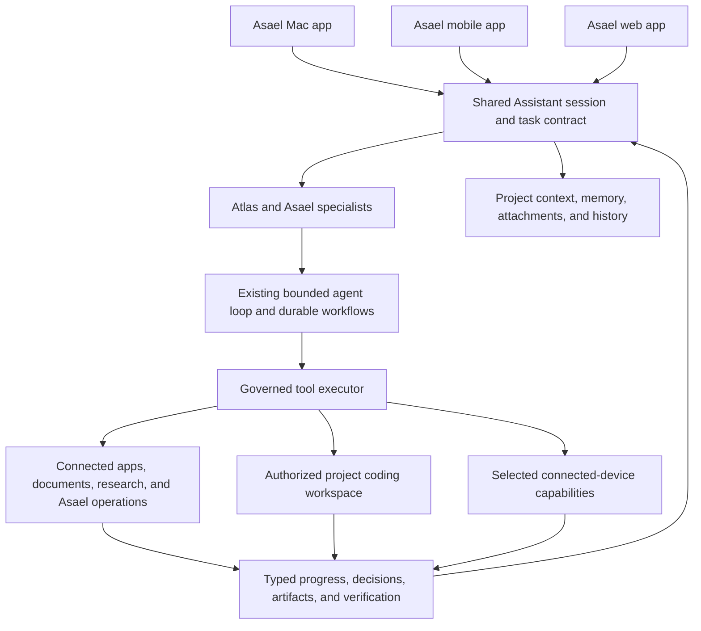

# Asael Assistant: Chat, Cowork, and Coding

Status: implementation candidate, 2 November 2026. Live release evidence is recorded separately.

The owner wants these experiences inside Asael on macOS, mobile, and web.
Codex, Claude Code/Cowork, and Cursor are interaction references, not applications
to install, embed, or use as external execution engines. This clarification
supersedes the earlier external-engine proposal.

## Product

One Assistant, one conversation and project history, and three useful ways to
work with Asael. Atlas coordinates Asael's own specialists and tools. Model
selection remains an optional existing setting; there is no coding-product
selector or dependency on a third-party coding application.

| Mode | User goal | Main workspace | Results |
| --- | --- | --- | --- |
| Chat | Ask questions, explore ideas, understand information, or make a plan | Conversation, selected context, sources, and voice | Answers, explanations, comparisons, and proposed next steps |
| Cowork | Give Asael an outcome involving documents, research, files, connected apps, or a multi-step project | Conversation, concise plan/progress, delegated work, and an output preview | Usable documents, spreadsheets, presentations, completed actions, and recorded evidence |
| Coding | Understand, build, debug, refactor, or review software in an authorized project/workspace | Conversation, project files, changes, preview, and command/check results | Actual edits, diffs, relevant verification, runnable outputs, and delivery when authorized |

These modes must change the experience and the admitted task behavior. Renaming
existing General, Act, and Knowledge labels alone is insufficient. Research
remains an available capability; it does not need a competing fourth main mode.

Mode changes preserve the conversation and selected context. They apply to the
next submitted work and do not silently reroute an already accepted run. A
request that needs another mode can offer a context-preserving transition.

## Shared interface

Preserve Asael's existing porcelain/deep-teal theme, typography, readable status
language, and restrained motion.

- **Header:** task title, current state, selected project, and a simple
  Chat / Cowork / Coding control.
- **Conversation:** the main working area. Stream answers and public activity;
  collapse completed routine steps. Keep questions and decisions inline.
- **Context:** attached files, selected project, and connected capabilities,
  revealed when useful rather than as a permanent wall of controls.
- **Work view:** a concise plan and the actual specialists currently contributing,
  with waiting, failed, interrupted, and completed states kept distinct.
- **Result view:** open the selected document, source, code diff, command result,
  or preview beside the conversation when space allows.
- **Composer:** one input, attachment/context access, voice, and Send or Stop.
  Put model, research depth, and advanced execution details behind options.
- **History:** shared task navigation and recovery across clients. Avoid separate
  unrelated chat systems for the three modes.

Use mode-specific empty states and examples. Chat starts with a question;
Cowork starts with an outcome and relevant files; Coding starts with a project
and a concrete change. Never populate progress or success with demonstration
data in the live workspace.

## Platform behavior

All three are first-class clients of the same Asael service and task model.
They share capability semantics while adapting their composition to the device.

| Client | Composition | Execution expectations |
| --- | --- | --- |
| macOS | Compact source list, dominant conversation, project file/result inspector; native keyboard, menu, and window behavior | Asael service tools, available cloud workspaces, and explicitly connected local Mac capabilities |
| Mobile | Touch-sized mode control, one dominant pane, files/progress/results as sheets or drill-down views | Submit and continue eligible service/cloud work; show connected-device dependencies truthfully |
| Web | Responsive conversation with optional project/files and result panes | Same authorized service/cloud workflows; connected Mac work requires an available Mac connection |

The Fold layout responds to available width and unobstructed display regions.
Folding preserves the draft, selected task, scroll position, and work state.
Do not require a phone to emulate a desktop IDE or run macOS commands locally.

## Mode and execution location are separate

The mode describes the user's task. Execution location describes where an action
actually runs: Asael's service, an admitted cloud coding workspace, or a selected
connected device. Show the meaningful project/location next to work when needed.

Do not present a cloud environment as available until its setup and admission are
verified. A cloud task cannot automatically see local Mac files or browser
sessions. A local task that needs a disconnected Mac must show that dependency;
it must not silently change to another execution target.

Selecting a task mode grants no new permissions. Existing workspace membership,
tool grants, device authorization, approval, and idempotency remain authoritative.
Routine work follows existing authority. Consequential decisions should be
grouped when the underlying operations support an exact coherent review.

## Architecture

Keep Atlas as the primary relationship. Reuse Scout, Forge, Sentinel, and other
authorized specialists where the task benefits from them. Ordinary questions
do not need a whole team. A task that does need delegation should expose useful
progress and return the specialists' actual outputs through the same session.

The selected mode must survive submission, queuing, retry, voice continuation,
history restoration, and cross-client recovery. Keep that product intent
distinct from older runtime modes and from device access. Do not assume a
cosmetic client-only field establishes server behavior or a new permission.

## Existing implementation to reuse

- Web Assistant: `src/app/app/command/page.tsx` and
  `src/components/agent-runs-workspace.tsx`.
- Shared native controllers and repositories:
  `apps/flutter/lib/features/talk/talk.dart` and
  `apps/flutter/lib/features/talk/talk_api_repository.dart`, with separate Mac
  and mobile presentation paths already present.
- Existing `/api/agent` admission, SSE progress, durable prompt queue, thread
  history, source/context selection, approval continuations, cancellation,
  artifacts, and voice context.
- Atlas orchestration and specialist delegation, existing project repository,
  source, checkpoint, command, verification, and delivery operations.
- Existing adaptive layouts, theme tokens, context sheets, and inspectors.

The large web/native conversation files should receive small composition hooks.
Put mode policy, mode controls, result panes, and focused controllers in their
own modules. Avoid another agent loop, parallel task database, duplicated
approval system, or new external-engine infrastructure.

The current Mac command runner is one capability inside the governed tool
system. Its duration limits and approval requirements do not need to be removed
merely to introduce these Assistant experiences.

## Implementation and acceptance

1. Define a shared, backward-compatible Assistant mode contract and map each
   mode onto existing admitted Asael capabilities. Preserve old conversations.
2. Implement the three-mode navigation, composer, contextual progress, and
   results across web and Flutter's Mac/mobile presentations.
3. Exercise real work through Asael: a sourced answer, a usable document from
   supplied notes, and a small authorized code change with a diff and relevant
   check. A UI capture alone does not establish any of those results.
4. Verify mode/context retention through history, prompt queuing, retry, voice,
   cancellation, and reconnection. Confirm no cross-account or project leakage.
5. Verify narrow and wide Mac windows, phone and simulated Fold sizes, web
   keyboard navigation, text scaling, light/dark themes, and reduced motion.
6. Package and release changed clients using the existing release procedure,
   with focused behavior checks and explicit platform-specific evidence.

Chat must not unexpectedly start consequential work. Cowork must show genuine
deliverables and action outcomes. Coding must disclose missing workspace access,
show actual changes and checks, and distinguish source edits, verification,
deployment, and installation. A request to wait for approval stays binding.

## Status of this correction

The three modes, shared history/queue/voice contracts, and project coding
workspace are implemented in the web and Flutter candidates. The file workspace
uses the existing Builder inside an adaptive dialog, preserving the conversation
beneath it. The focused validation and release procedure is documented in
`docs/assistant-workspace.md`; build, installation, and live verification results
remain separate evidence. The earlier research installed no coding products and
added no external-engine integration.
