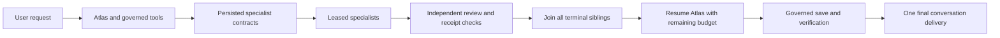

# Atlas delegation and completion

Atlas owns the user's outcome. A specialist is a bounded execution of an Agent
profile, not a continuously running persona. Atlas can select a built-in or an
active custom profile, delegate an independently understandable task, and finish
the dependent work after every specialist has a reviewed terminal result.

## Execution contract

- New dynamic tasks use `resume_parent`; previously persisted
  `terminal_result_only` contracts keep their delivery behavior. The last child
  transaction enqueues one deduplicated parent job. A completed child by itself
  is not completion of the user's request.
- The initial Atlas run saves its remaining, non-refundable budget and exact
  request authority before its terminal commit. The continuation validates the
  original owner, current membership, thread, stop marker, and every child. It
  uses the lower of saved and current roles, never system authority.
- An `after()` dispatcher leases only this parent's due jobs, two children at a
  time, within the route deadline. The durable queue remains the recovery path;
  the dispatcher never ticks unrelated watches or retries failed jobs early.
- A deterministic continuation run ID and atomic final-turn ID make completed
  job redelivery read-only. An interrupted, ambiguous running continuation fails
  explicitly instead of repeating possible effects. Pending approvals wait;
  cancellation propagates to the child jobs and continuation.
- The continuation receives reviewed results and scope-checked receipts for the
  parent's prior actions. Child text remains untrusted data. A rejected child is
  a blocker, not a successful contribution. Private/selected context grants are
  not widened: automatic continuation supports ordinary session, current-turn,
  or no-context requests, and declines unsupported context authority explicitly.

## Specialists and efficiency

Custom profiles retain their exact identity/model pins and tool allowlists.
Execution rechecks the account's current membership and the profile's status.
Canonical and legacy owner coordinates are bridged only from that account's
validated membership; the audit actor and mutation owner are not rewritten.

New `structured_read` contracts reserve 54,000 tokens, five model turns,
150 seconds and $0.60 for the child plus one independent review. New `research`
and `artifact_build` contracts reserve 104,000 tokens, seven model turns,
240 seconds and $1 including one correction and final review. Each review has
a 60-second allowance, bounded by the immutable overall deadline. Older contracts
retain their original slices and policy digests. A review timeout is reported as
`review_deadline_expired`; it never triggers a repeated model call. These are reservations, not measured
bills or a promised cost saving. Reservations are not refunded on queue retry.

Artifact tasks can return one bounded, digest-checked Markdown, plain-text or
patch draft. Atlas performs publication through its governed tools. Delegated
workers remain read-only and cannot recursively delegate or activate software.
The old `team` value is accepted only for stored compatibility; new requests use
`isolated` or `fork`.

## Evidence and truthful reporting

Tool selection considers the full bounded request and admitted dependencies.
Model-facing tool results remain valid JSON and declare omitted content, its
digest and full receipt location. Watch summaries retain readiness and recent
checks; older checks use a stable scheduled-time/ID cursor.

Fresh executed `web.read` observations may support claims only when their exact
tenant, actor, principal, run, scope, URL and trust bindings match. An observation
is neither a completed action nor proof of an accepted goal. Claim support,
tool outcome and goal acceptance are reported separately. Goal success requires
an explicit useful verdict or a successful outcome evaluator; a negative owner
verdict takes precedence. Only actual child executions count as specialist work.

`app.agents.improvements.prepare` produces a redacted, receipt-backed failure
fixture; `.compare` compares declared output fields in two owned runs with the
same prompt and reports regression or incomplete evidence. Neither operation
replays effects or activates a change. Software activation remains a separately
recorded build/release operation.

## Focused validation and release

The opt-in integration test uses an isolated PostgreSQL database and a
non-bypass runtime role to exercise terminal transactions, the parent outbox,
current-role restoration, legacy-owner reads, cancellation and one final delivery.
Its model callback is deterministic; it is not evidence of live model behavior.

The paired release can select `OMNIAGENT_RELEASE_FEATURE_PROBE=agent_completion_v1`
with a private `SMOKE_AGENT_COMPLETION_EVIDENCE_FILE`. Before promotion,
`scripts/smoke-agent-completion.mjs` signs in, creates fictional projects and a
custom reader, asks Atlas to use Scout plus that reader, and requires reviewed
results, a draft, one saved knowledge document and a verifying read. After
promotion it reads back those same records without another task. Failed evidence
is retained; paid POSTs are not retried automatically. Other releases omit this
probe. No database migration or native binary change is required for this work.
