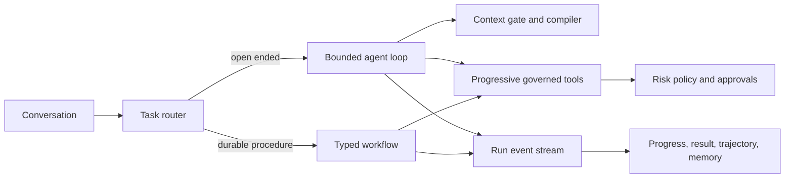

# Harness Engineering in Asael

The model is one replaceable component. The harness around it owns context,
capabilities, permissions, durable state, progress, evaluation, and recovery.
When a run fails repeatedly, improve that environment instead of adding a more
forceful prompt.

Availability adapters must verify timestamp semantics against the provider's
visible show labels before promotion. District's timezone-less `showTime` is
UTC: convert it to India time before applying the calendar date or inclusive
showtime bounds. Retain captured source evidence and test the noon boundary,
UTC date rollover, and expiry; a synthetic fixture alone cannot establish the
provider's timezone convention.

Shared service results may include agent-only continuation fields. Project the
published HTTP envelope explicitly, and parse actual route responses with the
unchanged client schema in focused regressions. Watch detail must preserve agent
pagination without adding its cursor to the fixed recent-history REST contract.

A paid release verifier may retry a transient read-only cleanup preview once
within its shared 60-second deadline. Never replay a paid turn or cleanup
mutation to recover an ambiguous response. A failed cleanup still blocks the
release, with the synthetic resource IDs and completed stages preserved.

Owner-locked self-improvement evidence reads must join the existing managed
transaction, including nested run, tool and scope-event readers. Verify that
path with Vercel's enforced one-connection pool; a wider local pool can hide
self-deadlock until the owner transaction times out. Preserve alias locks and
commit-uncertainty handling; do not retry the entire paid phase or raise the pool
limit to compensate.

Self-improvement tools must bind the current project and Builder session from
live server authority, rather than requiring the model to copy opaque IDs.
Remove those parameters from the model-facing contract, reject conflicting
supplied values, and inject the exact bindings before governed validation and
idempotency. Read-only inspection overflow may run in ordered bounded batches
only while the existing call, round, time, token and cost limits still cover
execution and final synthesis. Keep ordinary write and approval continuations
unchanged. Record bounded deferred-call identities and outcomes so incomplete
work can be diagnosed without retaining raw arguments.

An inspection is not complete merely because its agent run ended. Verify
executed, scope-bound reads of every selected implementation file and at least
one declared adjacent test before accepting a repair plan. Keep every declared
adjacent test in the later validation targets. A no-change decision also needs
an implementation read and a test read; instructions or documentation alone do
not establish that application behavior was inspected.

Model-facing Builder reads must preserve whole source lines and describe the
content actually delivered within the output limit. If projection shortens a
read, update its visible line range and truncation state and provide a usable
next-read location. Keep the original full-file hash and durable receipt. Do not
claim a complete read when only a prefix reached the model, or invent a resume
offset for an oversized single line. Builder search accepts one literal
substring; its description and results must not imply path-filter or query
language support.

After scoped discovery identifies an existing adjacent test and implementation
has been read, one bounded inspection-workflow episode may collect that test
and one necessary source continuation before further broad searches. Use the
same governed executor, checkpoints, owner/session scope and remaining budget.
Record the workflow as the initiator and bind its source discovery receipts;
do not fabricate model tool calls or infer filenames from an unverified plan.
Check current authority before each read and leave room for Atlas to interpret
the evidence in its existing model budget. A failed or partial episode stays
incomplete and is not replayed. Present collected content as untrusted evidence
for Atlas to interpret.

Workflow-issued reads retain the canonical `agent.tool.execute` execution
purpose required by the tool checkpoint contract. Record their workflow origin
in the causation and typed inspection receipt; a different initiator does not
change checkpoint authority. Exercise this path with the maintained expanded
checkpoint rollout enabled and assert persisted, correctly bound before/after
checkpoints. Calling a disabled checkpoint hook does not prove that boundary.
When an inspection workflow fails, preserve a closed failure-stage code and an
execution ID only when the executor actually returned it. Keep raw exception
messages and source content out of the completion receipt.

Give missing-read feedback inside the same bounded run, early enough to use
its remaining tool budget. Allow at most one final-submission correction, only
when the existing budget planner admits it. Preserve the phase reservation and
settle measured model usage before reporting failure. Never replay a paid phase
or manufacture read evidence to complete the inspection.

Persist the accepted inspection as a typed result bound to its actual read
receipts, separately from intermediate narration and rejected proposals. Parse
each final submission as one complete JSON result, optionally inside one matched
Markdown fence, with the exact schema. Do not extract a convenient object from
trailing prose or strip an incomplete-work notice into a successful decision.

Forge receives an accepted plan, not a new discovery task. Collect the selected
source and adjacent-test context through bounded, governed reads before broad
rediscovery consumes its writing budget. Keep live authority, exact workspace
bindings, truthful source paging and ordinary budget accounting. A final-only
budget turn cannot edit files; report that limitation as incomplete execution,
not a request to enable permissions that are already present. Never replay the
paid phase to compensate.

Agent completion alone does not prove a reproduction was written. Require an
executed, scope-bound file mutation and inspect the actual workspace diff.
Distinguish no changes, deletion and changes outside the selected test paths;
retain bounded path/hash metadata without source content. Settle known model
usage before reporting any failure. Exercise the real worker through test
creation, baseline failure, implementation, focused verification, independent
review and draft delivery on a synthetic defect. An inspection-only fixture
does not establish those later boundaries.

Verification profiles must agree with the stored database contract. Exercise
the actual verification insert after running the checksum-linked migration;
retain legacy profiles while admitting the current focused web and native
profiles. A mocked store or a manually relaxed local constraint cannot prove
that a candidate will save its verification in production.

Durable specialist execution must not inherit the fast scheduler's 45-second
request budget. Register its bounded promise with Next `after()` before starting
it, then let the fast tick return independently. Start leasing immediately after
registration so other tick work does not consume the child's acceptance window.
The drainer retains its 240-second ceiling, host teardown margin, atomic leases,
and every immutable child deadline and budget. A scheduled drainer is not a
completed task. Record deadline exhaustion as such rather than attributing it to
a user cancellation. Review-stage latency must fit the pinned model: new contracts
reserve 60 seconds per review and charge the complete lifecycle to the parent
before dispatch. Preserve older policy hashes and time slices. A late provider
reply cannot pass after the stage deadline, and timeout recovery cannot replay a
paid call. Test slow completion and timeout at the actual worker review boundary.

Do not infer a citation requirement from the bare words "source", "reference",
or "evidence" in a delegated criterion. They also describe saved app fields and
governed receipts. Only explicit citation or grounding requirements select the
citation validator; the independent reviewer still checks every criterion, and
required governed tool receipts remain a separate mandatory check. Existing
immutable contracts keep their original verification methods.

This direction follows OpenAI's
[harness-engineering guidance](https://openai.com/index/harness-engineering/)
and adopts the most useful legibility patterns from the MIT-licensed
[Waku Agent](https://github.com/ShenSeanChen/waku-agent) without copying its
local-only architecture or visual assets.

Queued specialists revalidate the admitted run mode and exact current profile
model policy; replacing either with a generic route creates false drift failures.
Parent continuations must carry the original canonical Agent identity even when
the audit owner is a legacy email. Database flow fixtures must exercise the real
identity-pin writer, not only a simulated completion callback. Explicit tool IDs
at the end of a sentence retain priority without matching longer dotted IDs.

The delegated prompt, example and immutable output schema must agree on artifact
fields. An optional draft cannot coexist with an instruction permitting only the
four receipt fields. The one tool-free correction uses structured generation
against the contracted schema, includes schema bytes in its reserved estimate
and request digest, and preserves exact runtime and usage receipts. Require
optional draft arrays as empty arrays for provider strictness without widening
legacy contracts. Keep malformed-output and missing-metering failures distinct.

Knowledge tools must pass their persisted execution timestamp and cancellation
signal through the application dispatcher. Actor-attributed ingestion always
constructs canonical source lineage, preserves the caller's idempotency key,
and reuses only an exact committed revision. Cover the real executor, dispatcher,
service and storage path; a mocked ingestion function with a hand-supplied
timestamp cannot prove that an agent can save and verify its work. Canonical
source transactions may queue their agent principal without rewriting it as a
user or system principal; exact owner checks and the transaction boundary remain
required. Include a focused PostgreSQL save/readback case with runtime RLS.

Specialist corrections receive a typed catalog of the child's admitted citation
IDs and successful governed execution IDs. Narrow the structured schema to that
catalog at both result and criterion level; service receipt hashes are not
canonical citations. Keep deterministic binding and independent semantic review
mandatory. Saved narrative fields support attributed scenario facts without
becoming instructions, independent verification or completed work. The writer,
correction and both reviewer paths share the same attribution rule. Assess the
complete structured proposal: a qualification quoted in a supporting criterion
note need not be repeated in each summary sentence. Preserve rejections for
material contradictions and explicit unsupported verification claims. Review only
the immutable requirements; do not invent a separate-field or embedded-citation
requirement. Replay captured source and proposal failures through the correction
boundary, including foreign receipts and contradictory values.

## Runtime shape



The harness is deliberately split into readable parts:

| Responsibility | Source of truth |
|---|---|
| Direct model/tool loop | `src/lib/orchestration/agent-runner.ts` |
| Direct versus durable routing | `src/lib/orchestration/supervisor.ts` |
| Typed durable plans | `src/lib/workflows/` |
| Context gate, retrieval, and trace | `src/lib/rag/context-engine.ts` |
| Progressive tool discovery | `src/lib/capabilities/toolbox.ts` |
| Policy, approval, and idempotency | `src/lib/tools/` |
| Run events and replay | `src/lib/events/`, `src/lib/runs/`, `src/lib/trajectories/` |
| Deterministic and governed evaluation | `src/lib/evaluations/`, `src/lib/evals2/`, `evals/` |

## Three evaluation lanes

For Atlas's durable specialist join, continuation authority, artifact drafts and
the selected staged release scenario, see
[Atlas delegation and completion](agent-execution-completion.md). Its database
candidate flow and live model scenario prove different boundaries; neither a
mocked model nor a clean build substitutes for the staged end-to-end result.

Evaluation surfaces have different effect boundaries and must not be treated as
interchangeable:

1. `evals/golden-tasks.json` and `scripts/run-evals.mjs` are the live model lane.
   They call `/api/agent` and may consume provider capacity. A ledger-replay
   corpus from `GET /api/evaluations/ledger-replay` runs in the same lane with
   `EVAL_TASKS_FILE`. It replays the caller's completed read-only runs and
   requires `EVAL_AGENT_ID` for a custom Agent with an active `read_only`
   principal. The server checks that same resolved identity before admission,
   forces direct execution, and withholds durable memory formation. A mutable
   tool definition is refused at the governed executor even if it changed
   after discovery. Run it against a candidate deployment, not production.
   Scoring requires a successful `done` event; incomplete or failed streams
   cannot pass, and any unpriced model call leaves the total cost unknown.
2. `src/lib/evaluations/` is the governed operational lane. It persists runs and
   may exercise database, queue, connector, or workflow behavior according to
   each case's governance metadata.
3. `evals/p05/suite.v1.json` and `src/lib/evals2/p05.ts` are the offline
   truth-regression lane. They accept only bounded synthetic fixtures and exact
   structured observations; parsing and scoring have no application side
   effects.

The live CLI runner requires `EVAL_EMAIL` and `EVAL_PASSWORD` in the operator
environment. It signs in through the app and runs with that account's session
cookie and trusted `Origin`; internal identity headers are not an alternative.
Optional `EVAL_TENANT_ID` and `EVAL_ACTOR_ID` assert the returned session identity
before any model turn. `BASE_URL` must be an HTTP loopback development origin,
the canonical production origin, or an Asael staged Vercel origin; ledger replay
should target a candidate. `VERCEL_AUTOMATION_BYPASS_SECRET` can admit requests to
a protected candidate. `SMOKE_INTERNAL_AUTH_SECRET` only labels synthetic
telemetry. The runner never retries a paid POST, redacts credentials from its
output, and attempts logout even when scoring or the stream fails. A failed
logout also fails the command.

The offline lane has no warning result. Every declared assertion is required,
and its domain-separated suite digest plus declared scorer version are intended
to bind later observed baselines. Scoring changes must bump that version. A
normative fixture is not evidence that the current application passes it. The
checked-in observation is reproduced from the real side-effect-free adapters,
and the authenticated Phase 0 production gate scores that fresh observation
before emitting its scoped, content-free receipt. A pass requires every case,
category, and Phase 0 row to pass with zero effects.

## Claim evidence is stronger than citation presence

The dormant P1.5 `ClaimEvidenceMapV1` contract in
`src/lib/rag/claim-evidence-map.ts` binds exact answer spans to canonical
evidence snapshots, pre-resolved authorization decisions, versioned semantic
assessment receipts, temporal state, and bounded inference. Weak methods such
as citation-ID matching and model assertion remain inspectable but cannot
produce a supported claim. Coverage is explicitly limited to the declared
material-claim set.

Its verifier is structural only. A verified receipt does not establish factual
truth, source or resolver trust, claim-decomposition completeness, or live RAG
adoption. The complete boundary and later activation gates are documented in
[ClaimEvidenceMap v1](vision/CLAIM_EVIDENCE.md).

## Checkpoints are compatibility evidence, not execution authority

The active P1.6 `RunCheckpointV1` contract in
`src/lib/runs/checkpoints.ts` records only immutable metadata and canonical
references at model, tool, approval, delegation, and verifier boundaries. It
binds the exact run scope, grants, purpose, engine and rollout generation,
harness and run-envelope identities, budget counters, boundary lifecycle, and
parent checkpoint. Mutation boundaries must also bind the governed tool
execution, persisted intent, idempotency identity, and effect receipt required
for that phase.

Compatibility is checked before state references are opened. Only an exact,
active `canary` or `enabled` rollout pin can be resumable. Shadow, inactive,
unsupported, or mismatched pins produce a safe pause; they never silently fall
back to the current engine. A checkpoint does not grant authorization, acquire
a lease, or permit an effect. Those facts must be revalidated transactionally
by a later resume worker. The complete contract and staged activation gates are documented in
[RunCheckpoint v1](vision/RUN_CHECKPOINTS.md).

Migration v68 and the transaction-only writer persist one exact parent-bound
checkpoint, its state-reference index, and `run.checkpoint.recorded` event in a
single existing transaction. New runs enrolled under the exact active shadow
generation use that writer for their first governed approval-wait boundary in
the canonical continuation transaction. It has no transaction opener and
returns `resumeAuthorityGranted: false`; persistence evidence must not be
mistaken for an executable continuation.

The governed approval transaction also records the exact approved or rejected
successor. An approved record precedes tool effect execution; a rejected record
is terminal. Both approval boundaries emit a strict matched comparison receipt
only after their chain, references, scope, tool/decision state, and resource
counters validate, and neither receipt grants resume authority.

`scripts/check-run-checkpoint-shadows.ts` is the bounded operator gate for this
shadow. It rereads one tenant's stored rows, reference indexes, typed events,
approval decision, and effect-receipt state; it does not open continuation
contents. Empty and mismatched samples fail closed.

Tenant maintenance runs the same check once a day for each tenant with an
active approval shadow, expanded shadow, or expanded canary rollout, and
records the report as a `run_checkpoint.shadow_reconciled` diagnostics event.
Its `matchedDays` counts consecutive matched days in the same mode; a missed
day, a mode change, or any other status starts the count again, and a mismatch,
incomplete coverage, or failed check is recorded as a warning. The approval
canary has no reconciliation mode and is not checked.

Passing `expanded` or `expanded_canary` as the command's final argument selects
the exact full-boundary shadow or canary configuration. Those modes additionally
require model, tool, approval, delegation, and verifier phase coverage; check
their exact pairs, chain and cumulative counters; and revalidate terminal
tool/effect receipts.
Incomplete coverage is a failing gate even when every observed row is valid.

`scripts/smoke-expanded-checkpoints.mjs` is a separate live, paid verification
that creates two temporary Agents and exercises an approved read plus a council
run. Its operator environment must supply `BASE_URL`, `EXPECTED_REVISION`,
`SMOKE_CHECKPOINT_EMAIL`, `SMOKE_CHECKPOINT_PASSWORD`, `SMOKE_TENANT_ID`, and
`SMOKE_ACTOR_ID`. The tenant and actor values must match the real account's login
response; they never establish execution identity. It also requires
`SMOKE_INTERNAL_AUTH_SECRET` (or `OMNIAGENT_INTERNAL_AUTH_SECRET`) for synthetic
telemetry only. The normal target remains the canonical production origin;
`SMOKE_CHECKPOINT_ALLOW_LOOPBACK=CONFIRMED` permits the local mock-server
regression harness. This switch changes only the client target allowlist, never
application authentication or authorization.

The checkpoint script follows each temporary Agent's exact Trash preview and
then its distinct purge preview, and attempts logout after all cleanup attempts.
It reports the original verification failure separately from cleanup and logout
failures; a retained Agent or unconfirmed purge cannot produce a passing result.
It never retries a paid agent POST. Run the local subprocess regressions before
an authorized live invocation:

```sh
npm run test:unit -- src/lib/evals2/run-evals-script.test.ts src/lib/release/operator-scripts.test.ts src/lib/release/smoke-paid-agent-script.test.ts
```

Migration v69 provides the resume fence. Claims bind the exact
checkpoint digest and operation job, persist only hashed credentials, advance
their generation only after expiry, and require the exact live token for
heartbeat or completion. Acquisition rechecks rollout, scope, run, decision,
tool state transactionally. Claim receipts explicitly deny resume authority.
The queue may call the binder only for the separately configured risk-0,
read-only, no-effect canary pin. It co-commits the fence and run transition
without storing the raw token; the same token and generation then fence claim
heartbeat and every terminal or next-wait run write. Generation 4 is active for
read-only canary runs after non-empty shadow and canary reconciliation plus a
hard-kill generation-reclaim proof; mutable and unsupported runs remain outside
that path.

## Checkpoint replay and correction create a new authority boundary

P1.7 forks never resume the source worker. `src/lib/runs/fork-store.ts` rereads
and validates the full checkpoint chain through the selected boundary, requires
the source event prefix to end at the exact matching
`run.checkpoint.recorded` receipt, and hashes a canonical prefix manifest. In
one tenant-scoped transaction it creates the target run, immutable v1 lineage,
fresh scope binding, and metadata-only `run.fork.created` / `run.forked`
events. The correction is present in the new run input; lineage stores only its
length and SHA-256.

The target begins queued with `continuation = NULL`. Its execution scope is
constructed from the current authenticated actor with explicitly new grant
sets and checkpoint causation. No source tool execution, approval, resume
claim, or provider continuation is copied. Any consequential action reached by
the corrected trace returns through the governed tool executor and creates a
new approval decision.

## One harness receipt per run

Every new agent run emits a durable `run.harness` event after context and
capabilities are resolved. It records the effective model route, context-gate
decision and trace ID, selected evidence IDs, tool and skill IDs, approval
policy, execution budgets, and hashes of the instructions and tool contracts.

The receipt is intentionally metadata, not hidden reasoning. It lets a person
answer: _What environment did this run actually receive?_ The conversation's
activity view presents the plain-language summary; trajectory export retains a
bounded receipt for replay and comparison.

Final council review and revision receive the same bounded current-run evidence:
role-labelled conversation, attached-file disclosures, saved and web context,
canonical citation IDs, and real governed tool outcomes. Each source class and
tool result has explicit coverage limits, so a large retrieved block cannot
silently crowd out a failed write or a newly read document. Truncation limits
verification; it does not erase a recorded execution. Regression checks must
exercise both direct and provider-neutral loops and the committed final answer,
not only the provisional streamed text.

Delegated review must receive the complete bounded proposal, including the
submitted criterion notes and receipt bindings, alongside independently
validated tool observations. A readable summary is not the entire proposal.
Do not discard structured proof and then reject the summary for omitting it;
equally, a successful receipt does not establish that every reported field is
correct. Keep source field names and observation times distinct. Explicitly
record coverage loss instead of silently truncating material claims.

For new delegation policies that reserve a correction cycle, review the first
proposal before completing the child. Permit at most one tool-free correction
using the same pinned working model and existing evidence, followed by another
independent review. Reserve and record each paid stage under the execution's
budget and cancellation fences before calling the provider. An interrupted,
ambiguous stage must not be paid again or treated as successful. Deliver only
the final accepted result or honest blocker once; never revive or rewrite an
earlier terminal task to make validation pass.

Responsibility review, scheduled checks and final governed dispatch use the same
versioned tool-authority digest. Only top-level tool names and descriptions are
display copy; schemas, approval metadata and all other contract fields remain
pinned. Exercise real registry definitions in regressions so a descriptive edit
cannot silently stop daily tracking. Historical whole-definition pins require a
fresh owner review. Recovery retains cumulative limits and original baseline
evidence through an explicit receipt; it cannot manufacture an observation or
silently restore notification delivery.

Size attached-file context after serialization, including pins, citations and
coverage disclosures. If excerpts do not fit, retain an honest bounded excerpt
and an exact source-reader request where possible; never advertise omitted text
as delivered evidence. A server-resolved reader preference survives approval
continuations but still intersects the current tool policy and permissions.
Pin the extraction receipt as well as the binary version when it is available,
so a same-file reindex cannot silently replace the selected source.

Keep complete small Work results available to the working model. For oversized
results, preserve exact commitment fields before narrative and disclose omitted
fields. The reviewer may compact only evidence actually delivered to the writer;
equal detail hashes establish text equality, not source agreement or successful
delivery. An executed tool may retain `approvalRequired: true` after approval;
that historical flag alone must not discard its observed result. None of these
model projections changes the full governed execution record.

Project readbacks retain their observed brief, commitment summary and task-page
coverage through review and revision. Prefer the latest independent read for
each exact scope and identity within the existing evidence budget; keep earlier
states and every execution status attributable rather than merging them into a
claimed current snapshot. If later pagination supplies only an excerpt, retain
the earlier full brief with its original observation; this does not establish
that its contents remained unchanged. Test realistic before/write/read sequences
with long briefs, failed writes and repeated reads. Cursor continuity can
establish a complete traversal, but current reads across pages are not an atomic
snapshot.

## Memory is controlled, not merely accumulated

The context engine decides whether durable retrieval is useful, and an
explicit user selection always wins. An empty explicit selection means no
saved context. Retrieved text remains untrusted evidence and is cited rather
than treated as instruction.

The native tool broker exposes three separate operations:

- `memory.write` adds a new record.
- `memory.correct` creates a corrected record and retains the previous claim as
  superseded or contradicted.
- `memory.forget` irreversibly scrubs one exact record and always requires human
  approval.

This mirrors Waku's useful self-managed-memory pattern while retaining
Asael's tenant isolation, evidence history, and approval controls.

## Golden rules

1. **Compile context just in time.** Do not put every memory, skill, or tool in
   every prompt. Explicit user choices take precedence over automatic routing.
2. **Keep the loop bounded.** Tool iterations, calls per turn, arguments,
   schemas, outputs, and model output all have hard limits.
3. **Put deterministic behavior in code.** Authorization, validation, retries,
   redaction, state transitions, and acceptance checks are not model duties.
4. **Use workflows for known shape.** A workflow arranges work around the same
   governed executor; it does not create an alternate security path.
5. **Record actions, not private thought.** Context decisions, model receipts,
   tool calls, approvals, errors, and outcomes are observable typed events.
6. **Degrade optional help gracefully.** Optional specialists or enrichment
   may warn and fall back; authorization, destructive actions, and tenant
   boundaries always fail closed.
7. **Make failures actionable.** User-facing messages describe recovery without
   leaking infrastructure details. Internal events retain sanitized categories
   and correlation IDs.
8. **Convert repetition into structure.** A recurring failure should become a
   tool contract, architectural constraint, focused evaluation, or documented
   runbook—not another paragraph in the system prompt.

For continuous voice, transport readiness is not capability readiness. Verify the
actual provider session's work tool, instruction digest and audio configuration
before enabling input, output or delegation; fail the call on later drift. Keep
the exact saved human request as the executable objective so a model's handoff
summary cannot substitute a different name or number. Exercise both absent-tool
sessions and an accurate transcript followed by an inaccurate handoff.

Spoken approval belongs to the authenticated client and the ordinary approval
endpoint, not to the model's tool interpretation. Present the exact pending action,
bind a fresh saved user caption to that presentation and session, and preserve all
normal decision gates and idempotency. Test action changes, stale or interrupted
speech, quoted or qualified agreement, cross-session evidence and replay. Describe
this as client-observed caption evidence, never biometric identity or provider
verification.

Routine task-authorized Mac navigation and media control do not require a new
approval for each step. Classify the observed target before input: a recognized
routine control may proceed, a critical effect needs exact action review, and an
unidentified target requires bounded fresh observation with no input or approval.
Do not ask the user to approve a mystery click. A human's explicit instruction to
wait for approval narrows the persisted run policy and survives continuation;
derive that hold from authenticated human input, never a model handoff or screen
content. Retain the server-derived hold through clarification; an ordinary answer
does not release it. Withhold background handoffs that cannot carry the same
policy, including from the saved continuation toolbox. A spoken-review failure
must remain visible across work polling and
require a fresh presentation before another decision. Test routine play/pause,
critical controls, unknown targets, explicit holds and interrupted review states
separately; an executed input receipt alone does not prove playback or navigation.

An advertised composite tool must retain its admitted prerequisites through ranking,
schema budgets and later policy filters. For research, test the full
`app.research.start` / `web.search` / `web.read` bundle and the authorized direct-reader
fallback. Initial search evidence does not complete an interactive task: exercise a
hotel follow-up that preserves dates and unresolved occupancy, performs a second
governed search, and still stops at the original call budget. Test supplied-source
restrictions outside Research mode as well as non-retryable provider failures.

Compile capability awareness from the final run toolbox. Test that an empty research
evidence envelope does not become a claim that sources were supplied, and that catalog
knowledge never becomes execution authority. Keep capability pages inside the full
serialized tool-result budget. For conversation sources, replay exact-run citations
and multiline history, including a late source response after the user changes chats.

Self-development reuses inspected source workspaces and existing governed edit,
checkpoint and verification tools. Test discovery with restricted Agent allowlists
and unavailable devices; adding source-tool preferences cannot restore removed
authority. Keep edited, tested, delivered, deployed and installed outcomes separate.

A full per-turn tool batch does not exhaust the run. Give each skipped call an
explicit unexecuted result, its call identity, the limiting allowance and the
remaining capacity. The model can request it again on an ordinary later turn;
never silently execute it or add turns beyond the existing budgets. Preserve
bounded unresolved-call hashes across approval waits, and label unfinished work
when a run ends without resolving them. Regressions must cover direct and
provider-neutral loops, approval continuation and actual run-limit exhaustion.

Specialist structured-output schemas must close every object. Encode arbitrary
tool arguments as a bounded JSON string on that wire, then parse and validate the
object through the existing broker and governed executor. Reject malformed
contribution evidence IDs before lifecycle persistence. Retain only bounded
failure stages, codes and usage-receipt IDs for diagnosis; transport correlation
must not cause the provider adapter and model gateway to record usage twice.

## Recurring failure feedback loop

Diagnose the executor of existing work before proposing recovery. A mission's
root milestone has no direct workflow; follow its task execution reference or
the originating run's delegated workflow instead of interpreting that absence
as work never started. A paused workflow is not a clarification request.
Research questions are the investigation agenda. Preserve the recorded failure,
saved source counts and actual draft presence in voice and agent diagnostics.
Keep status reads available while work is active. An authorized recovery uses
one existing governed signal and then reads back the same workflow; uncertain
model completion retains its explicit-resume fence and original budgets.
Durable model receipt hashes must not change with delivery time or unrelated
prompt updates. Snapshot bounded trusted report instructions before dispatch
and preserve the full request hash on recovery. A legacy reconstruction must
match a known exact variant; without a completed receipt, a resumed model call
is a new budgeted attempt.

Expected tool failures carry bounded recovery metadata through the governed
executor to the model. Native Mac refusals preserve the allowlisted code,
phase and reason; legacy clients explicitly report an unknown phase. The run
requires a fresh successful observation after a covered or stale target,
prevents unchanged hit-test retries, and bounds consecutive refused input.
Semantic Press remains a separately governed action. A successful native input
delivery ends the consecutive-refusal episode; it does not prove the user's
intended outcome. Confirm that outcome from readback. Snapshot-bound element IDs
are normalized only for conservative retry denial, never for target authority.
Failure receipts are opt-in for compatible Mac claims. An older server can
receive the legacy receipt; a lost acknowledgement never permits action replay.

Failed public reads preserve a fixed source-failure classification. A later
proposal to read the same normalized URL in that run is recorded as blocked
and unexecuted, consumes the existing tool-call budget, and makes no new HTTP
request. Alternative sources and search must already be admitted. These denial
rules survive approval pauses as exact tenant/actor/run metadata and hashes,
without screenshots, accessibility text or raw URLs. Filling the bounded failed
source history stops further public reads instead of silently forgetting failures.
Proposed and audited target hashes use the same redacted representation. These
rules grant no authority;
native device/snapshot checks and exact reviewed approvals remain in force.

Oversized project objectives and work-item details report the field, actual
length and limit before mutation. Correction must use a fresh governed identity
and verify readback; never truncate acceptance criteria, owners, dates or
dependencies to turn a failure into success. Text bodies preserve paragraphs.
Direct create replay keeps its historical whitespace equivalence and returns the
first saved layout, preserving older receipt digests through rollback. Governed
tool identity still binds the exact input before that store-level comparison.
Ordinary failed release artifacts retain bounded error-budget measurements;
diagnostic evidence cannot waive a release gate. Scripted model-turn regressions
prove these execution contracts, not live model judgment or production recovery.

Every persisted evaluation result produces a content-free observation. A
failed result is assigned one bounded deterministic category and fingerprint;
the minimized replay record keeps only suite/case/type, the current case
definition digest, a failure-signal digest, input JSON shape, expected keys,
and an explicit absence of mutation authority. Raw prompts, inputs, outputs,
errors, tool results, and reasoning are excluded.

The second consecutive matching failure activates a tenant-scoped cluster,
opens or updates its evaluation-regression incident, and proposes one
versioned harness response for operator review. The response may be a focused
evaluation case, tool contract, prompt change, workflow guard, architecture
constraint, or runbook. It cannot apply itself. Two focused passes resolve the
cluster and incident. Replay is allowed only while the stored case-definition
digest equals the current canonical case and still passes ordinary evaluation
governance without inherited mutation permission.

## Loop v2 interruption recovery gate

The fixed P6.1 suite interrupts the read-only Loop v2 canary at every resumable
state and exercises transient failures, cancellation, verification rejection,
stale fences, replans, non-replayable model boundaries, exhausted claims, and
invalid clarification state. Release requires at least 99% eligible recovery,
complete progress traces, and zero duplicate effects, false successes,
unfenced writes, or generic failure mutations. It invokes only the governed
`runs.list` read and grants no mutation or external-effect authority.

## Background notification preference reads

Background notification producers must not create Today preference defaults.
Resolve the candidate's current account and active membership in its exact tenant,
then read the saved canonical/current-email preference pair in the same managed
transaction as the disposition and outbox. Missing or ambiguous identity and
missing preferences fail closed; duplicate physical preference rows remain an
error. Keep the original candidate owner on decisions, receipts, and deliveries.
Regression coverage must include a canonical candidate with only legacy email
preferences and prove that evaluating it never creates another preference row.

## Continuity serving-role regressions

Agent mutation regressions must cross the governed executor, service and store
with the initiating user and executing Agent kept distinct. User-only store
tests cannot establish that an Agent can save work. Serving-role database tests
must use the migration's actual grants; fixture-only privileges can hide a
production failure. Workspace and membership revocation locks remain mandatory
even where a narrow database function is needed to acquire them.

Calendar-only commitments remain calendar dates throughout tool arguments,
storage, projections and client controls. Do not manufacture noon, midnight or a
device-derived zone to fit a timestamp field. Named human responsibility is not
an authentication principal. Validate dependency changes against the complete
same-project graph inside the write transaction, including concurrent opposing
edges. Current commitment counts must use saved fields and canonical outcomes;
they do not establish that a separately saved brief matches its sources.

Every additive migration must update the historical integration replay teardown,
reinstallation chain and restoration-version list together. Reject populated
feature fields before removing fixture objects; recreate them with the unchanged
production migration. Run the full integration suite: a passing new-feature
fixture does not exercise old predecessor checks or their recovery paths.

## Native controller replacement gate

An owner-scoped native controller must synchronously cancel reads, fence writes,
and clear private visible state when its repository, session, role, deployment,
or biometric authority changes. Provider disposal performs that invalidation
without notifying the widget tree from inside Riverpod teardown. It must also
fence an outgoing controller before a replacement provider rebuild completes;
waiting for a later UI notification is insufficient.

Riverpod invalidation runs disposal callbacks before replacing the outgoing
Ref, so `ref.mounted` alone does not establish current access. After dependency
reads, check both the Ref and the access state. Repository admission must also
recheck disposed/readable state after an authority probe returns. Regression
tests invalidate synchronously inside a probe before rebuild, retain framework
error collection, and assert that no new read or mutation is dispatched.

Mounted route tests replace the actual provider, including replacement under
the same owner, and assert that old editor contents and late responses cannot
reappear. Stateful editors and page-storage entries bind controller identity
where retained state would otherwise outlive the dependency. Focused provider
tests collect Flutter framework errors as failures; a passing assertion count
with disposal or build-time exceptions is not a successful validation.

An expansion tile and any nested scroll view need distinct, namespaced
`PageStorageKey` values. Otherwise the tile's boolean expansion state and the
scroll view's numeric offset can collide. Exercise the expanded content in
widget checks so the shared storage path is read, not only the collapsed tile.

## Native protected-storage recovery gate

macOS windows have separate Flutter engines. An isolate-local queue or Dart
file lock cannot establish an application-wide storage transaction. Protected
draft CAS and Capture append/delete operations use the shared host broker with
fixed namespace addresses, bounded ciphertext, a root kernel lock and exact
byte comparisons. Reads that can feed an upload join that broker as well.
Legacy cleanup is an exact authenticated deletion, never recursive pruning or
a filename-based claim that a file belongs to the current owner.

Timeouts and lost responses do not establish whether a write or deletion
completed. Keep the immutable request and accepted receipts, block another
effect, and reconcile by authenticated read without repeating the operation.
Capture entries restored after controller or application replacement require
explicit same-key retry; loading the queue never uploads them. Regression
coverage includes separate writers, quota races, replacement controllers and
process termination before/after publication. Those checks establish the
tested process-crash boundaries, not a power-loss durability certification.

Serving-role fixtures must preserve explicit migration revocations. In particular,
do not grant the private actor-identifier registry to a test login to make a new
native owner check pass. Use the exact current-owner boolean function, inherit
its narrow runtime grant, and assert that direct registry reads remain denied.
Fixture convenience grants must never conceal a production permission failure.

Bind structured receipt objects directly to JSONB parameters in tagged PostgreSQL
queries. Passing `JSON.stringify(receipt)` through the driver's JSON serializer
can persist a JSON string instead of the required object. Keep the SQL shape and
binding checks active so malformed acceptance cannot commit.
The same rule applies to JSONB merge patches: object concatenation with an encoded
string produces an array and can erase a job's actor binding when the next reader
rejects that shape. Recovery must check that the committed payload remains an
object with its exact actor, request hash and execution scope; do not infer a
replacement owner from a malformed historical payload.

A valid short transcript may produce a blank generated summary. Require nonempty
summary text in both the provider schema and local schema. If the provider still
returns an empty string, use explicitly labeled excerpts from real transcript
turns with their exact citations and a warning, rather than repeat a paid
generation or fabricate facts. Other malformed output must still fail validation.

When a native integration fixture rebuilds a generic preview or request, parse it
through the endpoint's narrow schema before passing it to a typed store. Preserve
the intended negative case, such as expiry or stale review, without widening the
request or hiding the mismatch with a cast. Hosted TypeScript checks include
integration fixtures as well as application code.

When adding application-service operations, update the architecture guide's
active count and include `src/lib/app-services/coverage.test.ts` in the first
focused validation pass alongside contract generation and route cases. The
registry and documented inventory must agree before a release build is published.

## Transitional paths expire

Every shadow, canary, legacy, versioned and retired path is registered in
`src/lib/architecture/complexity-registry.ts` with the area that owns it, the
measurement that lets it go, and an expiry no more than 180 days after its
review. The registry test scans the repository and fails when a file whose
name marks it transitional, an environment flag whose name does, an exported
capability rollout ID, or a route that answers 410 has no entry; when an entry
names something that no longer exists; and from an entry's expiry date. An
expired entry is resolved by meeting its exit metric and deleting the path, or
by reviewing it and setting a new date.

## What not to copy from a blueprint

Waku optimizes for a small, local, single-user assistant. Asael is a
multi-tenant governed runtime, so SQLite as the only store, unscoped local
credentials, and a single-process gateway are not suitable substitutions for
RLS, durable queues, signed evidence, or the paired web/worker release model.
Likewise, more agents are not automatically a better harness: specialist and
critic passes are used only where their additional judgment is worth the cost.
